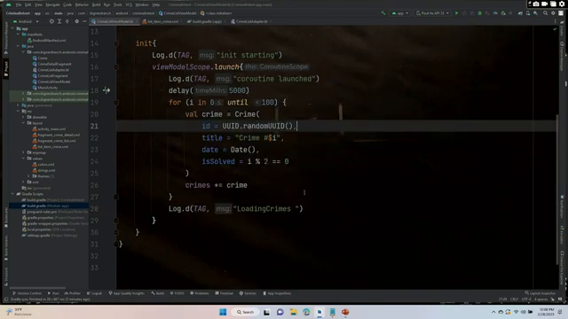
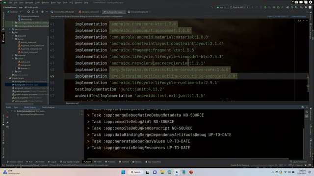
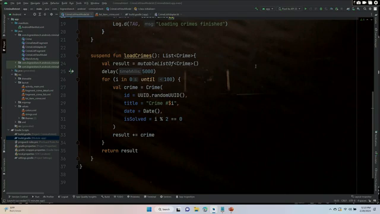
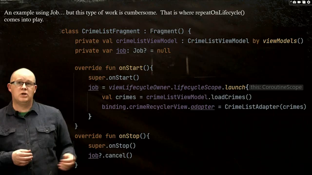
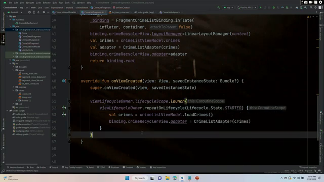
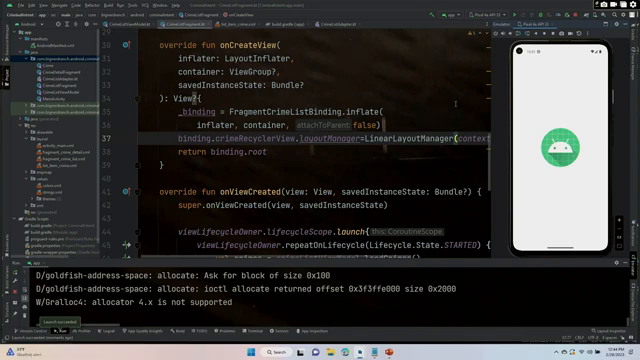

# CriminalIntent lecture and assignment stages

The project was rebuilt from the committed chapter 10.7 checkpoint, then advanced through videos 12.1 and 12.2, the in-class activity, and HW4. Each stage has a source ZIP outside the repository, and the original working source was backed up before restoration. Git history and the staging index were preserved.

The previous HW4 implementation already included much of the coroutine behavior. This rebuild makes the lecture prerequisites separate, inspectable stages and aligns the final code more closely with the actual video, including its cleanup. The final working project contains both completed assignments.

## Source checkpoints

The checkpoints are saved in `C:\Users\Jnuso\AndroidStudioProjects\3200-stage-backups\lecture-rebuild-2026-10-22-a51a6d6d`:

| Checkpoint | Contents |
| --- | --- |
| `original/CriminalIntent/` | Working source immediately before this rebuild, including the earlier HW4 implementation and guide. |
| `00-before-in-class.zip` | Exact chapter 10.7 source from commit `8ba35e7`. |
| `01-video-12.1-intentional-empty-list.zip` | Coroutine initialization and five-second delay; deliberately retains the lecture's blank-list bug. |
| `02-video-12.2-working-list.zip` | Suspended loader and lifecycle-aware adapter creation, including the end-of-video cleanup. |
| `03-in-class-reapplied.zip` | The lecture baseline plus the handcuff row layout and solved-state binding. |
| `04-hw4-reapplied.zip` | HW4 launcher icons, observation logs, and commented Job experiments, with repeatOnLifecycle active. |

Each ZIP contains a `CriminalIntent/` directory. To inspect a historical stage, extract its ZIP to a separate directory and open the contained project. Keep normal development in `C:\Users\Jnuso\AndroidStudioProjects\3200\CriminalIntent`. Generated build files and caches are excluded from the checkpoints.

## Before the lectures

Chapter 10.7 generated all 100 crimes synchronously in `CrimeListViewModel.init`. `CrimeListFragment.onCreateView` could immediately do this:

```kotlin
val crimes = crimeListViewModel.crimes
val adapter = CrimeListAdapter(crimes)
binding.crimeRecyclerView.adapter = adapter
```

At that point the data already existed. `CrimeHolder.bind()` was also already implemented. The in-class handcuff row and coroutine loading were absent at this checkpoint.

## Video 12.1

Evidence: the transcript introduces dependencies at 5:25-6:40, then adds `viewModelScope.launch` at 6:56-7:41, logging and a delay at 8:00-10:16, and diagnoses the empty list at 11:47-13:07.

We added explicit dependencies for:

```kotlin
implementation(libs.androidx.lifecycle.viewmodel.ktx)
implementation(libs.androidx.lifecycle.runtime.ktx)
implementation(libs.kotlinx.coroutines.core)
implementation(libs.kotlinx.coroutines.android)
```

The video uses lifecycle 2.5.1 and coroutines 1.6.0. This project keeps the versions already resolved by its current Android libraries: lifecycle 2.10.0 and coroutines 1.9.0. Both coroutine artifacts use the `org.jetbrains.kotlinx` group. We did not copy the lecture's temporary dependency typo or downgrade the Android project.

The ViewModel changes to:

```kotlin
init {
    Log.d(TAG, "init starting")
    viewModelScope.launch {
        Log.d(TAG, "coroutine launched")
        delay(5000)
        // Generate the existing 100 Crime objects here.
        Log.d(TAG, "Loading crimes finished")
    }
}
```

The fragment still creates its adapter immediately. While the coroutine is suspended, that adapter sees an empty list. Filling the mutable list later does not notify the adapter, so the rows stay absent. This is the intentional timing/ordering problem at the end of video 12.1; the snapshot is not the final working app. It does not require two threads modifying the list simultaneously.





## Video 12.2

Evidence: the transcript extracts the suspending function at 2:33-4:16, shows the Job alternative at 5:15-6:18, writes repeatOnLifecycle at 6:49-10:27, and removes the old setup at 10:31-11:13. The rotation demonstration is at 11:33-11:48.

The five-second delay and generation loop move into a function matching the screenshot's capitalization:

```kotlin
suspend fun loadCrimes(): List<Crime> {
    val result = mutableListOf<Crime>()
    delay(5000)
    // Generate each Crime and add it to result.
    return result
}
```

The ViewModel's initialization coroutine keeps `crimes += loadCrimes()`. The fragment also calls the loader directly. These are separate calls, which is how the video and homework example are written. No shared repository or database is introduced in these two videos; video 12.3 begins the database work.

The fragment's final loading code becomes:

```kotlin
override fun onViewCreated(view: View, savedInstanceState: Bundle?) {
    super.onViewCreated(view, savedInstanceState)
    viewLifecycleOwner.lifecycleScope.launch {
        viewLifecycleOwner.repeatOnLifecycle(Lifecycle.State.STARTED) {
            val crimes = crimeListViewModel.loadCrimes()
            binding.crimeRecyclerView.adapter = CrimeListAdapter(crimes)
        }
    }
}
```

The adapter is now installed after the suspending function returns its completed list. The coroutine runs when the view is STARTED or RESUMED and its repeating block is canceled when it falls below STARTED. Rotation creates a new view and runs this one-shot loader again, producing another five-second delay, as demonstrated in the lecture.

The cleanup matters:

- Remove the fragment's old `onCreate` override and size log.
- Remove the old `val crimes`, `val adapter`, and adapter assignment from `onCreateView`.
- Keep binding inflation, the layout manager, and `return binding.root` in `onCreateView`.
- Keep clearing `_binding` in `onDestroyView`.

The instructor shows manual Job code on a slide but says he is not adding it to the final lecture version. We preserve that distinction: Job alternatives belong to the subsequent HW4 experiments.









## Reapply the in-class activity

The three in-class files were reapplied from commit `aa3049c` without overwriting the new lecture loading code:

- `CrimeListAdapter.kt`: bind `crimeSolved.visibility` to `crime.isSolved` for every row.
- `list_item_crime.xml`: use ConstraintLayout, add the right-aligned handcuffs, set the specified constraints and margins, and apply Headline6 to the title and date.
- `drawable/ic_handcuffs.png`: the supplied icon.

The chapter 10.7 delegation from adapter to `CrimeHolder.bind()` remains intact. No homework launcher change is included in the in-class snapshot.

## Reapply HW4

The final version adds the cyan handcuff launcher assets, initial/completed ViewModel count logs, and the required manual Job experiments. The loader is named `loadCrimes()` everywhere, matching the video. The PDF's lowercase `loadcrimes()` is the same exercise; Kotlin is case-sensitive, so calls must use one spelling consistently.

To retain the lecture cleanup, the fragment's old `onCreate` log is provided as a commented **HW4 OBSERVATION** block. Enable it temporarily while recording the initial-count experiments, then comment it again. The completed list is loaded directly inside `onViewCreated`, as shown in the video; the earlier extra `loadAndDisplayCrimes()` helper and cancellation catch were removed.

Only the final repeatOnLifecycle method is active by default. The onStart/onStop and onResume/onPause alternatives remain commented, and the final version adds one `Displayed 100 crimes` log for observing UI completion. See [the HW4 recording guide](HW4_WALKTHROUGH.md) for the exact switching steps and explanations.

## References

- Supplied `12.1.mp4` and `12.2.mp4`, with their attached transcripts; screenshot timestamps are listed above.
- Supplied in-class activity document and HW4 PDF.
- [Android repeatOnLifecycle reference](https://developer.android.com/reference/androidx/lifecycle/RepeatOnLifecycleKt)
- [Android lifecycle coroutine scope](https://developer.android.com/reference/androidx/lifecycle/LifecycleCoroutineScope)
- [Kotlin Job reference](https://kotlinlang.org/api/kotlinx.coroutines/kotlinx-coroutines-core/kotlinx.coroutines/-job/)

## Verification after rebuilding

All five source checkpoints compiled successfully: the original 10.7 baseline, video 12.1, video 12.2, the reapplied in-class activity, and the reapplied HW4 version.

| Runtime check | Observed result |
| --- | --- |
| Video 12.1 | Loading finished after the delay, but no crime rows appeared, matching the lecture's intentional ordering bug. |
| Video 12.2 | The list appeared after loading. Rotation created a fresh loading interval, then the rows returned in landscape. Rotation settings were restored afterward. |
| In-class activity | Title/date layout displayed correctly; handcuffs appeared on the visible solved rows and were absent from unsolved rows. |
| Final repeatOnLifecycle | Leaving during the delay prevented UI completion; returning loaded and displayed 100 crimes. |
| Manual onStart/onStop | Initial fragment and ViewModel logs showed 0; onStop canceled UI work, and returning created a fresh load. |
| Manual Job without onStop | The UI load completed while the app was in the background and its view still existed. |
| Manual onResume/onPause | onPause canceled UI work, and returning started a fresh load. |
| Final launcher | The cyan handcuff icon opened the restored final app, which displayed its list. |

After the experiments, the final source was restored exactly and rebuilt. Only repeatOnLifecycle is active; manual Jobs and the temporary onCreate observation override are commented out. The in-class files still match commit aa3049c. Git HEAD remains aa3049c, and the staging index is unchanged. No commit or push was made.

Final Android lint result: **0 errors, 14 warnings**. The warnings are advisory dependency/version, unused-resource, bitmap-density, and version-catalog notices. The updated sources and runtime logs are saved locally; the source checkpoints exclude generated build outputs.